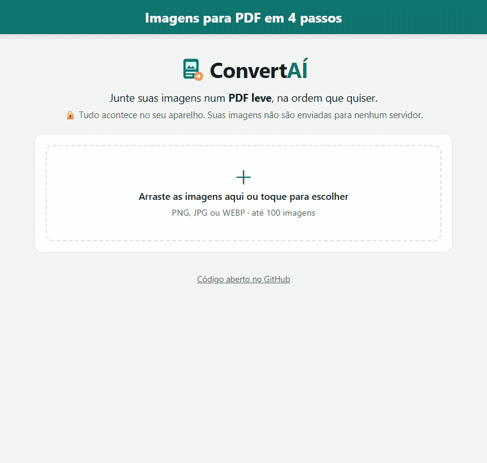

<div align="center">


# ConvertAÍ

**Suas imagens viram um PDF leve, direto no navegador.**

[](https://clauberteixeira.github.io/ConvertAI/)




</div>

## Como funciona

| Passo | O que você faz |
|:---:|---|
| **1** | Abra o [ConvertAÍ](https://clauberteixeira.github.io/ConvertAI/) e **arraste as imagens** para a página (ou toque para escolher). |
| **2** | **Organize a ordem**: arraste, use as setas ou clique em "Ordenar por nome". Cada imagem vira uma página. |
| **3** | **Escolha a qualidade**: alta, equilibrada ou arquivo menor. Se quiser, diga o **tamanho máximo** em MB. |
| **4** | Clique em **Gerar PDF** e depois em **Baixar PDF**. Pronto! |

Funciona no computador e no celular, sem instalar nada.

## 🔒 Suas imagens ficam com você

A conversão acontece **no seu próprio aparelho**. As imagens não são enviadas para nenhum servidor,
então ninguém além de você tem acesso a elas.

## Detalhes

- Até **100 imagens** por PDF, nos formatos **PNG, JPG e WEBP**. O tipo é conferido pelo conteúdo do
  arquivo, não pelo nome.
- Cada página tem o lado maior do tamanho de uma folha **A4**, e o outro lado acompanha a proporção da
  imagem. Partes transparentes ficam brancas.
- Com **tamanho máximo**, o ConvertAÍ comprime um pouco mais a cada tentativa até caber. Se não der,
  entrega o menor PDF possível e avisa.
- Imagens quebradas ficam de fora, com um aviso dizendo quais foram.

## Para quem programa

É um site estático, sem etapa de build. Para rodar localmente:

```bash
python -m http.server 8000   # depois abra http://localhost:8000
npm test                     # testes (Node 20 ou mais novo)
```

O PDF é montado com [pdf-lib](https://github.com/Hopding/pdf-lib) (licença MIT, cópia em `vendor/`).

## Licença

[MIT](LICENSE). Pode usar, copiar e modificar à vontade.
